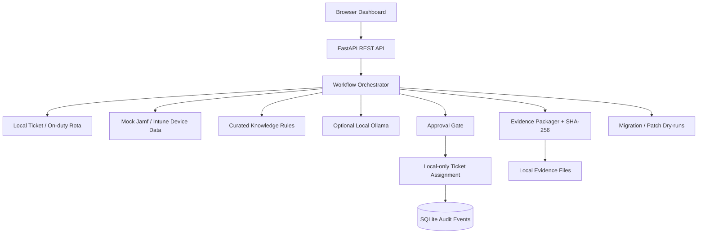

# WorkplaceOps AI

**A runnable, local-only enterprise IT automation portfolio project** showing how a workplace engineering team can reduce manual work without giving an AI model privileged access to production systems.

**Python 3.11+ · FastAPI · SQLite · HTML/CSS/JavaScript · Optional local Ollama · pytest · Docker · GitHub Actions**

> **Safety / scope:** This repository contains fictional users, devices, tickets, and meetings. It has **no live Jamf, Intune, Okta, Microsoft Graph, Zoom, email, or service-desk integration**. All mutations are confined to a local SQLite database. AI summaries default to explainable deterministic drafting; a local language model is optional. This is not a production-ready IAM, MDM, audit, or migration system.

## What you can demonstrate

| Workflow | What works locally | Real-world boundary |
|---|---|---|
| Ticket triage | Read a fictional helpdesk ticket; classify by rules; attach fictional endpoint evidence; select an on-duty engineer; create an idempotent approval proposal; write a local simulated assignment after review | No ServiceNow/Jira integration or real ticket writes |
| AI handoff | Produce a traceable engineer handoff using rules + curated KB; optionally use locally hosted Ollama to draft from these facts | No LLM decision-making, privilege escalation, or automatic execution |
| Compliance evidence | Normalize Mac/Windows records; map illustrative controls; export JSON snapshot + SHA-256 manifest; detect tampering | No real MDM API calls, immutability, attestation, or certified compliance |
| Patching communications | Target only devices with overdue patches and preview the message | No email delivery or device change |
| Calendar cutover | Find Teams meetings still needing attention; flag recurring and external-attendee risks; draft owner-approved recreations | No real calendars accessed or automatic Teams→Zoom conversion |
| Engineering practices | OpenAPI docs, audit events, isolated tests, Docker configuration, CI checks | No production auth, role enforcement, monitoring/alerting or deployment |

## Architecture



The rules and device facts are the source of truth. A model can draft readable explanation but cannot approve or invoke a write operation. See [`docs/ARCHITECTURE.md`](docs/ARCHITECTURE.md).

## Step-by-step setup (macOS, Linux)

**Prerequisites:** Python 3.11 or 3.12, Git. A browser. Docker and Ollama are optional. No cloud account, database installation, Node.js, secrets, or paid API is required for the base demo.

1. Download and unzip the project. Open Terminal in the project folder:

   ```bash
   cd workplace-ops-ai
   ```

2. Confirm Python and Git:

   ```bash
   python3 --version
   git --version
   ```

   If Python is not installed on a Mac, install the current compatible Python 3 release from [python.org](https://www.python.org/downloads/) and reopen Terminal.

3. Create and activate a virtual environment:

   ```bash
   python3 -m venv .venv
   source .venv/bin/activate
   ```

   Your prompt should now begin with `(.venv)`.

4. Install the application and testing dependencies:

   ```bash
   python -m pip install --upgrade pip
   python -m pip install -r requirements-dev.txt
   ```

5. Run the automated tests before starting the application:

   ```bash
   python -m pytest -q
   ```

   All tests should pass. The current checked-in suite covers rules, approval idempotence, evidence tamper detection, patch targeting, and migration dry-runs.

6. Start the application:

   ```bash
   python -m workplace_ops
   ```

   Keep this Terminal open. Expected: `Uvicorn running on http://127.0.0.1:8000`.

7. Visit these addresses in a browser:

   - **Dashboard:** http://127.0.0.1:8000
   - **Interactive API documentation:** http://127.0.0.1:8000/docs
   - **Service health:** http://127.0.0.1:8000/api/health

8. In the dashboard, run the workflows in this order:

   - Choose **T-1001** and **Analyze selected ticket**. See the Jamf source, noncompliant state, relevant knowledge article, on-duty owner, and proposed assignment.
   - Enter `Demo Reviewer` and select **Approve simulated assignment**. Check the audit event and updated ticket counts.
   - Select **Generate evidence package**, then **Verify latest package**. Check the generated files under `artifacts/evidence/<run-id>/`.
   - Select **Preview notification plan**. See only overdue devices in the draft notification list.
   - Select **Build safe migration plan**. See flagged recurring or externally attended meetings requiring organizer approval.
   - Optionally choose **Draft AI handoff** for the currently selected ticket. Without Ollama, this is an explicitly labelled deterministic draft.

9. From a **second Terminal** in the same project folder, you can run an end-to-end API walkthrough:

   ```bash
   bash scripts/demo.sh
   ```

10. Stop the server with **Control+C**. To reset the fictional data before another interview:

    ```bash
    bash scripts/reset_local.sh --yes
    python -m workplace_ops
    ```

### Optional: true local LLM generation through Ollama

The main demo is fully functional **without** a model. If you want to show a model handling the ambiguous language in ticket handoffs, install [Ollama for macOS](https://ollama.com/download), follow its setup instructions, and download a small local model:

```bash
ollama --version
ollama pull llama3.2
```

Make sure the Ollama service is running (launch the macOS app; in a terminal-only installation, run `ollama serve` if it is not already active). In the Terminal that will run the Python app:

```bash
source .venv/bin/activate
export WORKPLACE_AI_MODE=ollama
export WORKPLACE_OLLAMA_MODEL=llama3.2
python -m workplace_ops
```

In the dashboard, choose **Draft AI handoff**. The response will be labelled `ollama-local` and list the tool trace. The output is **advisory**; an engineer must review it. Running the model requires local download time, storage, and enough memory, so do not rely on it for a time-constrained demo. The endpoint sends only bounded demo data to `127.0.0.1:11434`.

To disable the model and return to the reliable offline mode:

```bash
unset WORKPLACE_AI_MODE
python -m workplace_ops
```

## Optional: Docker version

With Docker Desktop installed and running:

```bash
docker compose up --build
```

Open http://127.0.0.1:8000. Local artifacts are persisted to `./artifacts/`. When finished:

```bash
docker compose down
```

Docker uses the same deterministic demo. For optional local Ollama, prefer the Python/native setup above; Docker-to-host model networking has not been configured here.

## Repository layout

```text
workplace-ops-ai/
├── .github/workflows/ci.yml       # GitHub Actions tests on Python 3.11 + 3.12
├── workplace_ops/
│   ├── app.py                     # API endpoints, docs, web hosting
│   ├── ai.py                      # optional loopback Ollama only
│   ├── db.py                      # SQLite schema and seed initialization
│   ├── fixtures.py                # all-fictional sample data
│   ├── service.py                 # business workflows and audit events
│   └── triage.py                  # explainable routing + curated KB
├── web/
│   ├── index.html                 # dashboard
│   ├── styles.css                 # styles
│   └── app.js                     # browser interactions
├── tests/                         # automated integration + domain tests
├── scripts/demo.sh                # curl walkthrough
├── scripts/reset_local.sh         # clear demo state explicitly
├── docs/                          # design decisions, demo plan, real-API roadmap
├── Dockerfile
├── docker-compose.yml
├── requirements.txt
├── requirements-dev.txt
├── LICENSE
└── README.md
```

## API examples

Start the server, then from a separate Terminal:

```bash
# Read-only health
curl -s http://127.0.0.1:8000/api/health

# Safe ticket analysis; creates a pending LOCAL proposal
curl -s -X POST http://127.0.0.1:8000/api/tickets/T-1001/triage

# Preview patches; does not send messages
curl -s http://127.0.0.1:8000/api/patches/plan

# Preview a Teams-to-Zoom transition; no calendar edits
curl -s http://127.0.0.1:8000/api/meetings/plan

# Generate an integrity-checkable fictional evidence package
curl -s -X POST http://127.0.0.1:8000/api/evidence/runs
```

Use the Swagger interface at `/docs` to discover the other routes and perform manual requests. The approval API intentionally accepts a **demo label, not a secure identity**; do not deploy this application to a public host.

## GitHub publishing (first time)

1. Verify the app works and tests pass.
2. On GitHub, choose **New repository**, name it `workplace-ops-ai`, and **do not** initialize it with a README, license, or `.gitignore` (those files are already included). Use Public visibility only if you are comfortable sharing the code.
3. In Terminal, from the **project root** (the folder containing `README.md`):

   ```bash
   git init -b main
   git add .
   git status
   git commit -m "Build local enterprise workplace automation demo"
   git remote add origin git@github.com:YOUR_GITHUB_USERNAME/workplace-ops-ai.git
   git push -u origin main
   ```

4. Replace `YOUR_GITHUB_USERNAME` with your **actual** username. The SSH remote assumes you've set up GitHub SSH authentication; see [GitHub's SSH guide](https://docs.github.com/en/authentication/connecting-to-github-with-ssh). Alternatively use GitHub Desktop to publish this local folder, or use HTTPS with Git Credential Manager. GitHub account passwords **do not** work for Git pushes over HTTPS.
5. All further feature development should happen on a branch:

   ```bash
   git switch -c feature/triage-dashboard-improvements
   # edit and test your changes
   python -m pytest -q
   git add .
   git commit -m "Improve triage workflow UX"
   git push -u origin feature/triage-dashboard-improvements
   ```

6. Open a **pull request** into `main`, confirm CI is green, review, then merge.

If you already have a Git repository or remote, **inspect before reinitializing**:

```bash
git status
git remote -v
```

For a demo interview, the most persuasive GitHub page has: a clear README, an architecture diagram, test results, real screenshots from your local browser, a clean commit history, and one or two meaningful pull requests. Do not upload confidential data, a real interview transcript, tenant identifiers, secrets, or internal customer examples.

## Documents

- [Architecture, control boundaries, and rationale](docs/ARCHITECTURE.md)
- [Three-minute hiring-manager demo](docs/INTERVIEW_DEMO.md)
- [Real-world connectors and permission plan](docs/REAL_CONNECTORS.md)
- [Security controls and known limitations](docs/SECURITY_AND_LIMITATIONS.md)
- [How to measure the actual time savings](docs/ROI.md)

## License

MIT. This is an independent fictional engineering portfolio, not an endorsed product or a real enterprise implementation.
